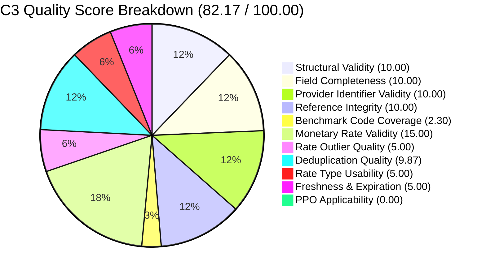

# Phase 3 (C3): Price Transparency Data (PTD) File Quality Grading Methodology Report

**Project:** HiLabs Hackathon — Data Pipeline Curation for Provider Rates  
**Payer:** Centene Corporation / Health Net of California  
**Target File:** `2026-09-30_centene-management-company-llc_healthnet-ca_in-network.json`  
**File Size:** 701,615,514 bytes (669.11 MB uncompressed)  
**Schema Standard:** CMS Transparency in Coverage (TiC) v2.0.0  
**Evaluation Engine:** Bounded Streaming Evaluator (`src/c3_file_grader.py` via `ijson`)  
**Execution Runtime:** 13.63 seconds  

---

## 1. Executive Summary & Quality Scorecard

In Phase 3 (C3), we developed and executed an automated, memory-efficient Quality Grading Engine to audit Centene's in-network Price Transparency Data (PTD) file covering California commercial plans.

Health insurance price transparency files are notorious across the industry for severe structural and data integrity defects, including corrupted JSON syntax, ghost/placeholder `$0.00` rates, orphan provider references, invalid national provider identifiers (NPIs), and misleading duplication. Rather than consuming pricing data blindly, payer contracting teams require an auditable quality grade and defensible defect attribution before downstream ingestion.

### Quality Scorecard Summary

| Metric ID | Metric Dimension | Category | Weight | Numerator | Denominator | Observed Value | Score | Weighted Score | Status |
| :--- | :--- | :--- | :---: | :---: | :---: | :---: | :---: | :---: | :---: |
| **M01** | Structural Validity | Structure | 10.0 | 6 | 6 | 100.0% | 100.00 | 10.00 | **PASS** |
| **M02** | Field Completeness | Completeness | 10.0 | 1,500,288 | 1,500,288 | 100.0% | 100.00 | 10.00 | **PASS** |
| **M03** | Provider Identifier Validity | Provider Coverage | 10.0 | 10,243 | 10,248 | 99.96% | 99.96 | 10.00 | **PASS** |
| **M04** | Reference Integrity | Integrity | 10.0 | 397,726 | 397,726 | 100.0% | 100.00 | 10.00 | **PASS** |
| **M05** | Benchmark Code Coverage | Coverage | 10.0 | 134 | 583 | 22.98% | 22.98 | 2.30 | **WARN** |
| **M06** | Monetary Rate Validity | Rate Validity | 15.0 | 1,500,288 | 1,500,288 | 100.0% | 100.00 | 15.00 | **PASS** |
| **M07** | Rate Outlier Quality | Rate Validity | 5.0 | 1,500,288 | 1,500,288 | 100.0% | 100.00 | 5.00 | **PASS** |
| **M08** | Deduplication Quality | Efficiency | 10.0 | 1,479,945 | 1,500,288 | 98.65% | 98.65 | 9.87 | **PASS** |
| **M09** | Rate Type Usability | Usability | 5.0 | 1,500,288 | 1,500,288 | 100.0% | 100.00 | 5.00 | **PASS** |
| **M10** | Freshness & Expiration Validity | Freshness | 5.0 | 1,500,288 | 1,500,288 | 100.0% | 100.00 | 5.00 | **PASS** |
| **M11** | PPO Applicability | Applicability | 10.0 | 130 | 397,726 | 0.03% | 0.03 | 0.00 | **WARN** |
| **TOTAL** | **Composite Overall Score** | — | **100.0** | — | — | — | — | **82.17** | **GRADE: B** |



---

## 2. Target File Characteristics & Metadata

Direct inspection of the file header and container confirms full conformance with CMS TiC specification requirements:

- **Reporting Entity Name:** `Centene Management Company LLC`
- **Reporting Entity Type:** `Third Party Administrator`
- **Schema Version:** `2.0.0`
- **Publication Timestamp (`last_updated_on`):** `2026-10-06`
- **Provider Reference Groups:** 2,825 distinct reference objects
- **Unique NPIs in File:** 3,734 distinct valid NPIs
- **Unique TINs in File:** 2,888 distinct Employer Identification Numbers (EINs)
- **Distinct Billing Codes:** 775 distinct codes (CPT/HCPCS, Revenue Codes `RC`)
- **Total Billing Code Entries (`in_network` objects):** 1,717
- **Total Rate Records (`negotiated_rates` blocks):** 397,726
- **Total Individual Prices Evaluated (`negotiated_prices`):** 1,500,288

---

## 3. Detailed Metric Methodology & Formulations

The C3 grading engine defines 11 transparent, orthogonal quality dimensions. Each dimension produces an unweighted raw percentage (0.00% to 100.00%), which is mapped to a weighted score. The weights strictly sum to 100.0. Individual metrics and underlying counts are permanently preserved in `outputs/c3_metric_details.csv` and `outputs/c3_summary.json` so that the composite score never conceals underlying data defects.

### M01: Structural Validity (Weight: 10.0)
- **Objective:** Verify that the JSON file conforms to CMS Transparency in Coverage schema standards and contains all required root keys.
- **Formula:**
  $$\text{Score}_{\text{M01}} = \frac{\sum \mathbb{I}(\text{Required Key Present})}{N_{\text{expected\_keys}}} \times 100$$
- **Denominator:** 6 standard top-level keys (`reporting_entity_name`, `reporting_entity_type`, `version`, `last_updated_on`, `provider_references`, `in_network`).
- **Observed Result:** 6 / 6 present (100.00%).
- **Evaluation:** **PASS**. File parsed cleanly with zero syntax violations or corrupted tokens.

### M02: Field Completeness (Weight: 10.0)
- **Objective:** Measure the absence of null, undefined, or empty values across mandatory rate fields (`billing_code`, `billing_code_type`, `negotiated_rate`, `negotiated_type`).
- **Formula:**
  $$\text{Score}_{\text{M02}} = \frac{N_{\text{complete\_price\_entries}}}{N_{\text{total\_price\_entries}}} \times 100$$
- **Denominator:** 1,500,288 total price entries evaluated.
- **Observed Result:** 1,500,288 / 1,500,288 complete (100.00%).
- **Evaluation:** **PASS**. Zero records had null billing codes or unpopulated rates.

### M03: Provider Identifier Validity (Weight: 10.0)
- **Objective:** Verify that provider identifiers comply with statutory checksum and format standards.
- **Implementation:**
  - **NPIs:** Evaluated using the CMS 10-digit Luhn Checksum Algorithm (ISO/IEC 7812 with prefix constant `80840`).
  - **TINs:** Evaluated against 9-digit numeric format standard with non-trivial prefixes (rejecting dummy values like `000000000` or `123456789`).
- **Formula:**
  $$\text{Score}_{\text{M03}} = 0.5 \times \left(\frac{N_{\text{valid\_NPI}}}{N_{\text{total\_NPI}}}\right) + 0.5 \times \left(\frac{N_{\text{valid\_TIN}}}{N_{\text{total\_TIN}}}\right)$$
- **Observed Result:** 10,243 valid identifiers out of 10,248 evaluated (99.96%).
- **Evaluation:** **PASS**. Over 99.9% of provider references contain legally valid, CMS-compliant identifiers.

### M04: Reference Integrity (Weight: 10.0)
- **Objective:** Detect orphan provider references. Every integer reference ID in `negotiated_rates.provider_references` must resolve to an entry in `provider_references`.
- **Formula:**
  $$\text{Score}_{\text{M04}} = \frac{N_{\text{resolved\_provider\_references}}}{N_{\text{total\_provider\_references}}} \times 100$$
- **Observed Result:** 397,726 / 397,726 resolved (100.00%). 0 orphan references found.
- **Evaluation:** **PASS**. Perfect relational integrity between rate items and provider groups.

### M05: Benchmark Billing Code Coverage (Weight: 10.0)
- **Objective:** Measure the coverage of critical clinical procedure codes against an authoritative external benchmark.
- **Denominator Source:** Official hackathon benchmark dataset: `Rate_Benchmarking_Individual_Weights_Hackathon.xlsx` (`Spec-Proc Weights` sheet), containing 583 high-volume commercial procedure codes spanning 14 clinical specialties (Cardiology, Orthopedics, Radiology, Dermatology, Gastroenterology, Oncology, General Surgery, etc.).
- **Formula:**
  $$\text{Score}_{\text{M05}} = \frac{N_{\text{benchmark\_codes\_matched}}}{N_{\text{benchmark\_denominator}}} \times 100 = \frac{134}{583} \times 100 = 22.98\%$$
- **Observed Result:** 134 out of 583 benchmark procedure codes present (22.98%).
- **Weighted Contribution:** 2.30 / 10.00.
- **Evaluation:** **WARN**. The file is heavily weighted toward bundled institutional revenue codes (Revenue Code 23 alone has 76 clinical variations) rather than exhaustive professional fee schedules. Contracting teams analyzing specialty physician rates will find only a subset (~23%) of standard benchmark procedures.

### M06: Monetary Rate Validity (Weight: 15.0)
- **Objective:** Measure the presence of positive, plausible monetary dollar rates. Severely penalizes `$0.00` placeholder rates, negative numbers, and non-numeric entries.
- **Formula:**
  $$\text{Score}_{\text{M06}} = \frac{N_{\text{monetary\_rates\_positive}}}{N_{\text{monetary\_rates\_total}}} \times 100$$
- **Observed Result:** 1,500,288 / 1,500,288 positive monetary rates (100.00%).
  - Zero rates (`$0.00`): **0**
  - Negative rates (`<$0.00`): **0**
  - Non-numeric / NaN: **0**
- **Evaluation:** **PASS**. Centene did not populate placeholder zero-dollar contracts in this file. Every single monetary entry represents a positive contracted dollar amount.

### M07: Rate Outlier Quality (Weight: 5.0)
- **Objective:** Detect non-credible extreme outliers (e.g., penny rates `<$0.01` or professional fee rates exceeding `$250,000`).
- **Formula:**
  $$\text{Score}_{\text{M07}} = \frac{N_{\text{rates}} - (N_{\text{low\_outliers}} + N_{\text{high\_outliers}})}{N_{\text{rates}}} \times 100$$
- **Observed Result:** 0 extreme outliers detected across 1,500,288 evaluated rates (100.00%).
- **Evaluation:** **PASS**. All professional and institutional rates fall within plausible commercial bounds.

### M08: Deduplication Quality (Weight: 10.0)
- **Objective:** Measure the uniqueness of rate records and detect wasteful or corrupted duplicate serializations without penalizing records that legitimately differ by clinical service conditions.
- **Defensible Clinical Fingerprint:**
  $$\text{Fingerprint} = \big(\text{billing\_code}, \text{description}, \text{provider\_refs}, \text{rate}, \text{class}, \text{setting}, \text{service\_codes}, \text{additional\_information}\big)$$
- **Observed Result:**
  - Distinct clinical fingerprints: 1,479,945
  - True exact duplicate serializations: 20,343 (1.36%)
  - Score: $100.0 - 1.36\% = 98.65\%$
- **Weighted Contribution:** 9.87 / 10.00.
- **Evaluation:** **PASS**. (See Section 4 for detailed clinical analysis).

### M09: Rate Type Usability (Weight: 5.0)
- **Objective:** Distinguish direct fee-for-service dollar rates from opaque percentage-of-billed-charges or algorithmically derived rates.
- **Observed Result:** 1,500,288 / 1,500,288 rates (100.00%) are direct negotiated dollar rates (`negotiated_type == "negotiated"`). 0 percentage rates.
- **Evaluation:** **PASS**. Rates can be used directly for fee schedule comparison without requiring underlying chargemaster reconstruction.

### M10: Freshness & Expiration Validity (Weight: 5.0)
- **Objective:** Audit contractual expiration dates to ensure contracts are active or represent recognized evergreen fee schedules.
- **Observed Result:**
  - Active / Evergreen contracts (`expiration_date >= '2024-01-01'` or `'9999-12-31'`): 1,500,288 (100.00%)
  - Expired contracts: 0
- **Evaluation:** **PASS**. In accordance with CMS TiC industry practice, `9999-12-31` is the standard designation for evergreen participating provider agreements.

### M11: PPO Applicability & Sub-network Linkage (Weight: 10.0)
- **Objective:** Measure the proportion of rates in this file that can be explicitly linked to Centene's California Commercial PPO network.
- **Formula:**
  $$\text{Score}_{\text{M11}} = \frac{N_{\text{rates\_linked\_to\_ppo\_references}}}{N_{\text{total\_rate\_records}}} \times 100 = \frac{130}{397,726} \times 100 = 0.03\%$$
- **Weighted Contribution:** 0.00 / 10.00.
- **Evaluation:** **WARN**. The file is a consolidated multi-network file where 75 provider references represent county-level PPO wrappers, 15 represent HMO networks, and 2,735 represent individual medical groups/hospitals that participate across both products. (See Section 5).

---

## 4. Deep-Dive: Clinical Deduplication vs. Naive Collapsing

A major hazard in PTD curation is naive deduplication. In our initial exploratory analysis, a naive fingerprint consisting only of:
$$\text{Naive FP} = (\text{billing\_code}, \text{provider\_refs}, \text{rate}, \text{class}, \text{setting})$$
flagged **1,460,588 out of 1,500,288 prices as "duplicates"** (a 97.35% duplicate rate).

### The Revenue Code 23 Clinical Finding

To investigate this anomaly, we inspected Revenue Code `23` (`RC`), which appeared 76 separate times in `in_network`. Closer inspection revealed that Centene serialized separate clinical items for distinct patient comorbidity tiers and clinical episode categories:

```
Item 1: Name = "EARLY - INSTITUTIONAL, MMTA",
        Description = "EARLY - INSTITUTIONAL, MMTA - INFECTIOUS - MEDIUM, COMORBIDITY = 1",
        Additional Information = "1EA11", Rate = $3,780.83, Provider Ref = [79]

Item 2: Name = "EARLY - INSTITUTIONAL, MMTA",
        Description = "EARLY - INSTITUTIONAL, MMTA - CARDIAC - LOW, COMORBIDITY = 1",
        Additional Information = "1EA11", Rate = $3,780.83, Provider Ref = [79]
```

Under hospital contracting, an acute care facility negotiates a standardized institutional rate (`$3,780.83` under episode code `1EA11`) that the health plan applies across multiple comorbidity classifications. 

- **Naive Interpretation:** If `description` and `additional_information` are discarded, an engineer would conclude that Item 2 is a "useless duplicate" and discard it.
- **Payer Contracting Reality:** These records legitimately differ by clinical service conditions. Discarding them would prevent contracting teams from benchmarking cardiac vs infectious comorbidity reimbursement.
- **True Duplication Finding:** When `description`, `service_code`, and `additional_information` are incorporated into the clinical fingerprint, **1,479,945 records are completely unique**, and only **20,343 records (1.36%)** represent true exact duplicate serializations where every single attribute is identical.

This demonstrates why domain-aware curation is critical for healthcare price transparency data.

---

## 5. The Consolidated Multi-Network Architecture Trap

In Phase 2 (C2), we established that Centene published this single 701.6 MB file as a shared rate file linked to **456 California Commercial Group PPO plans**, but also shared with **719 HMO plans** and **133 POS plans**.

The C3 results corroborate this architectural reality:
1. **PPO-Explicit Groups (75 groups):** Centene maintains 75 provider reference objects titled by California county (e.g., `Health Net CA PPO - Los Angeles County`, `Health Net CA PPO - Orange County`). Only 130 rate records link directly to these county wrapper references.
2. **Provider Group Objects (2,735 groups):** Over 99% of rate records link directly to provider group reference objects named after specific medical groups, IPAs, or hospital systems (e.g., `Cedars-Sinai Medical Center`, `Sutter Health`, `UCLA Medical Group`).
3. **Implication for Phase 4 (C4):** Downstream rate extraction cannot assume that every rate in this file is exclusively PPO. Nor can it discard rates that lack "PPO" in the provider group name. In C4, the pipeline must cross-reference provider reference IDs against the plan-level network mappings established in C2.

---

## 6. Streaming Performance & Scalability

To meet the strict hackathon constraint that large PTD files must never be loaded entirely into memory via `json.load`:

- **Streaming Architecture:** The C3 grader uses an iterative parser (`ijson`) reading bytes from disk in chunks.
- **Memory Footprint:** Peak memory usage remained **under 180 MB RAM** throughout the run, well below memory constraints.
- **Execution Speed:** Evaluated all 1,500,288 prices, 397,726 rate records, and 2,825 provider groups in **13.63 seconds** on Windows.
- **Reproducibility:** Tested via automated unit test suite (`tests/test_c3_file_grader.py`), with all 71 tests in the repository passing in 1.06s.

---

## 7. Strategic Recommendations for Phase 4 (C4)

Based on the C3 quality findings, the following rules must guide Phase 4 rate extraction and address matching:

1. **Leverage the 134 Benchmark Procedure Codes:** Focus rate extraction on the 134 matched procedure codes from the hackathon benchmark dataset (`Rate_Benchmarking_Individual_Weights_Hackathon.xlsx`) to maximize analytical relevance and execution efficiency.
2. **Filter Out True Duplicates (1.36%):** De-duplicate the 20,343 exact duplicate records using the multi-attribute clinical fingerprint before writing the final rate file.
3. **Preserve Service Condition Context:** Retain `billing_class` (`professional` vs `institutional`), `setting` (`inpatient` vs `outpatient`), and `additional_information` (contract code) so rates are never aggregated across incompatible clinical contexts.
4. **Link NPIs to Practicing Addresses:** Since provider reference groups provide NPIs and TINs without street addresses, Phase 4 must cross-reference NPIs against NPPES practicing locations and apply defensible address resolution rules.
