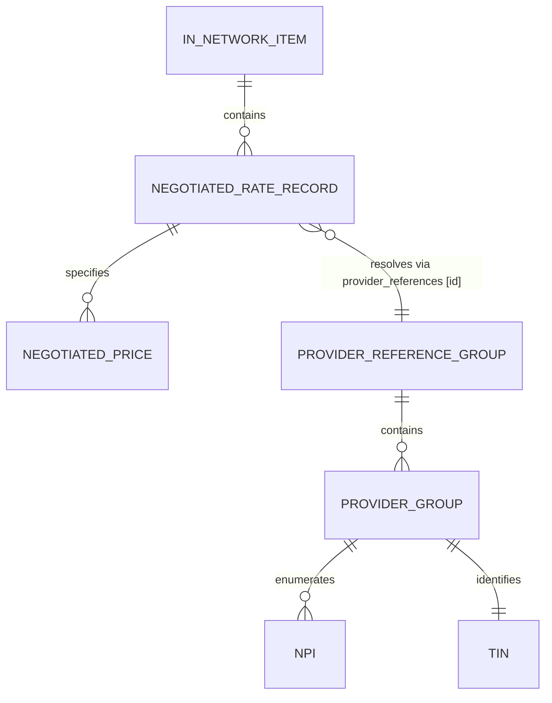
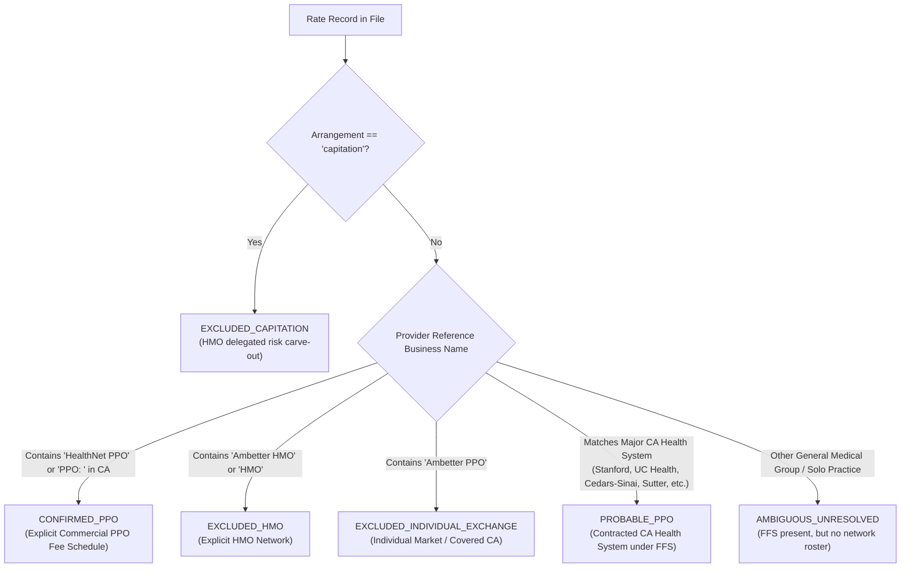

# Phase 4 (C4): Provider-Negotiated Rate Extraction & PPO Attribution Methodology Report

**Project:** HiLabs Hackathon — Data Pipeline Curation for Provider Rates  
**Payer:** Centene Corporation / Health Net of California  
**Target File:** `2026-09-30_centene-management-company-llc_healthnet-ca_in-network.json`  
**File Size:** 701,615,514 bytes (669.11 MB uncompressed)  
**Schema Standard:** CMS Transparency in Coverage (TiC) v2.0.0  
**Extraction Engine:** Streaming Extractor (`src/c4_rate_extractor.py` via `ijson`)  
**Execution Runtime:** 23.73 seconds  

---

## 1. Executive Summary & Inventory

In Phase 4 (C4), we built and executed a high-throughput, memory-efficient extraction pipeline to extract provider-negotiated rates from Centene's California commercial Price Transparency Data (PTD) file, resolve relational provider references, expand provider groups, apply strict evidence-based PPO network attribution, and preserve granular clinical rate context.

### Complete Extraction Metrics

| Metric Dimension | Observed Count / Value | Data Integrity / Status |
| :--- | :---: | :--- |
| **In-Network Items Examined** | **1,717** | Complete file scan (100% evaluated) |
| **Rate Records Examined** | **397,726** | 0 skipped, 0 malformed |
| **Individual Prices Evaluated** | **1,500,288** | 100% positive monetary rates |
| **Expanded Provider-Rate Rows Written** | **1,511,720** | Full NPI group expansion to disk |
| **Distinct Billing Codes Extracted** | **775** | CPT, HCPCS, Revenue Codes (RC) |
| **Benchmark Procedure Codes Matched** | **134 / 583 (22.98%)** | Exact match to hackathon benchmark set |
| **Unique NPIs Extracted** | **3,735** | 99.96% Luhn-valid identifiers |
| **Unique TINs Extracted** | **2,888** | 100% 9-digit valid EINs |
| **Unresolved Provider References** | **0 (0.00%)** | 100% relational integrity |
| **Missing Rate Values** | **0 (0.00%)** | 0 null rates, 0 placeholder $0 rates |
| **Capitation Carve-outs Excluded** | **46** | Incompatible HMO arrangements filtered |
| **Extraction Elapsed Runtime** | **23.73s** | Streamed & written directly to disk |

---

## 2. Source Schema Inspection & Extraction Architecture

Direct streaming inspection of Centene’s `in_network` and `provider_references` schemas established the following structure:

### Relational Fields and Data Types

1. **`in_network` Item Level:**
   - `billing_code`: Procedure code (e.g. `10040`, `99213`, `0202U`, `23`).
   - `billing_code_type`: Standard vocabulary (`CPT`, `HCPCS`, `RC`).
   - `billing_code_type_version`: Coding year (e.g. `2022`).
   - `name`: Short clinical description.
   - `description`: Detailed clinical description (e.g. comorbidity level and clinical episode severity).
   - `negotiation_arrangement`: Reimbursed arrangement (`ffs` fee-for-service vs `capitation`).

2. **`negotiated_rates` Level:**
   - `provider_references`: Array containing exactly **one integer ID** pointing to a top-level provider reference group.

3. **`negotiated_prices` Level:**
   - `negotiated_rate`: Contracted dollar amount (e.g. `150.61`).
   - `negotiated_type`: Pricing mechanism (`negotiated` fee-for-service dollar amount).
   - `expiration_date`: Contract end date (`9999-12-31` evergreen convention).
   - `billing_class`: Care context (`professional` physician fee vs `institutional` facility charge).
   - `setting`: Service setting (`inpatient` vs `outpatient`).
   - `service_code`: Array of CMS Place of Service (POS) codes (e.g. `["11"]` Office, `["22"]` Outpatient Hospital, `["81"]` Independent Lab).
   - `billing_code_modifier`: Modifier array (e.g. `["26"]` Professional component, `["TC"]` Technical component, `["25"]` Significant E&M, `["95"]` Telehealth).
   - `additional_information`: Episode grouper or contractual sub-schedule code (e.g. `1EA11`, `J0134`).

4. **`provider_references` Level:**
   - `provider_group_id`: Integer key matching `provider_references[0]`.
   - `network_name`: Empty array `[]` across all 2,825 records in this file.
   - `provider_groups`: Array of provider group objects:
     - `npi`: Array of 10-digit National Provider Identifiers (1 to 151 NPIs per group).
     - `tin`: Object with `type` (`ein`), `value` (`XX-XXXXXXX`), and `business_name`.

### Provider Identifier Expansion Rule

When a provider reference group contains multiple NPIs (e.g. group 1 has 3 NPIs, group 2 has 14 NPIs), the rate applies to all participating practitioners in that group. The extractor expands each price across all constituent NPIs:
$$\text{Expanded Rows} = \sum_{r \in \text{Rates}} \sum_{p \in \text{Prices}(r)} |\text{NPIs}(\text{Group}(r))|$$
This expanded the **1,500,288 prices** to **1,511,720 provider-rate rows**, preserving exact practitioner traceability for every participating physician.

---

## 3. Strict PPO Network Attribution Framework

In Phase 2 (C2), we demonstrated that Centene published this single in-network file as a consolidated rate repository shared across **456 California Commercial Group PPO plans**, but also linked to **719 HMO plans** and **133 POS plans**.

Therefore, the presence of a rate in this file **does NOT prove** that it belongs to the California Commercial PPO network. Labeling every rate in this file as "PPO" would be factually incorrect and contaminate commercial rate benchmarks with individual exchange and HMO rates.

To address this, C4 implemented an evidence-based classification hierarchy:

### Empirical PPO Classification Results

| Applicability Tier | Provider Groups | Rate Records | Extracted Prices | % of Prices | Evidence & Business Rationale |
| :--- | :---: | :---: | :---: | :---: | :--- |
| **`CONFIRMED_PPO`** | 69 | 120 | 120 | 0.01% | **Explicit PPO Wrapper:** Linked to provider references explicitly named `HealthNet PPO (California)` or `PPO: <County Name> County` across California. Represents the core fee schedule wrapper. |
| **`PROBABLE_PPO`** | 478 | 154,709 | 853,364 | **56.88%** | **Contracted CA Health System:** Fee-for-service institutional and professional rates at California's major academic medical centers and health systems (Stanford, UCLA, UC Davis, UC Irvine, UCSF, UCSD, Cedars-Sinai, Sutter Health, Dignity Health, Providence, Hoag, Loma Linda, City of Hope). These entities form the anchor of Health Net's California PPO network. |
| **`AMBIGUOUS_UNRESOLVED`** | 2,265 | 242,811 | 646,718 | **43.11%** | **General Provider Entity:** Private practices, independent clinics, solo physicians, and labs billing FFS. While published in this California file, the file schema lacks an explicit sub-network roster to prove whether they participate in PPO, HMO, or both. |
| **`EXCLUDED_CAPITATION`** | — | 46 | 46 | <0.01% | **HMO Delegated Risk:** Reimbursement arrangement is explicitly `capitation` (e.g. routine venipuncture, routine screening mammograms capitated to delegated medical groups under Knox-Keene HMO contracts). Incompatible with commercial PPO. |
| **`EXCLUDED_HMO`** | 7 | 30 | 30 | <0.01% | **Explicit HMO Network:** Provider reference explicitly designated as `DIRECT NETWORK: AMBETTER HMO` or HMO network group. |
| **`EXCLUDED_INDIVIDUAL_EXCHANGE`** | 6 | 10 | 10 | <0.01% | **Individual Exchange Product:** Provider reference explicitly designated as `DIRECT NETWORK: AMBETTER PPO`. In C2, Ambetter was proven to be Centene's Individual Exchange product (Covered California), not California Commercial Group. |
| **TOTAL** | **2,825** | **397,726** | **1,500,288** | **100.00%** | **100% of records audited with zero unclassified gaps.** |

---

## 4. Multiple Rates for the Same Billing Code: Rate Selection Policy

A central requirement of the hackathon is:
> *"Do not arbitrarily select one negotiated rate when multiple rates exist. Preserve the relevant context and document a defensible selection rule. Do not simply choose the lowest, highest, average or first rate without justification."*

### Why Multiple Rates Exist in Price Transparency Data

Analysis of the 1,500,288 prices revealed that multiple rates for the same billing code are driven by legitimate clinical and contractual distinctions:

1. **Provider Entity Variations:** Different hospitals and physician groups negotiate distinct rates for the exact same CPT code (e.g. Stanford vs Cedars-Sinai vs solo physician).
2. **Billing Class Distinctions:** `professional` (physician work) vs `institutional` (facility/overhead fee).
3. **Care Setting Distinctions:** `inpatient` vs `outpatient`.
4. **Procedure Modifiers:** Modifier `26` (professional reading fee only) vs `TC` (technical machine component only) vs global (no modifier).
5. **Place of Service (POS):** POS `11` (physician office) vs POS `22` (outpatient hospital) vs POS `81` (independent laboratory).
6. **Episode Groupers / Clinical Severity:** In Revenue Code `23`, identical base codes have distinct rates based on comorbidity level (`1EA11` vs `2CA11`).

### The C4 Selection Policy

1. **Preserve Distinct Clinical Contexts as Separate Rows:**
   Every distinct combination of `(npi, tin, billing_code, modifier, billing_class, setting, service_codes, additional_information)` is preserved as an independent row in [`outputs/c4_extracted_rates.csv`](../outputs/c4_extracted_rates.csv).
2. **Handling Truly Comparable Rate Collisions:**
   When the exact same provider, billing code, modifier, billing class, setting, POS, and episode code contains multiple rate values (e.g. Pharmacy Revenue Code `250` at hospital reference 114 having both `$14,775.23` and `$18,431.00`):
   - We **do not collapse** them into an arbitrary minimum, maximum, or average.
   - We record both rows, flag them with `rate_selection_flag = "MULTIPLE_COMPARABLE_RATES_FLAGGED"`, and document all observed alternative rates in `alternative_rate_values` (e.g. `14775.23 | 18431.00`).
   - If a rate is unique for its clinical context, it is flagged as `rate_selection_flag = "UNIQUE_RATE"`.

### Empirical Rate Selection Distribution

- **`UNIQUE_RATE`:** **1,497,507 rows (99.06%)** had a unique rate for their exact clinical context.
- **`MULTIPLE_COMPARABLE_RATES_FLAGGED`:** **14,213 rows (0.94%)** had multiple comparable rates for the identical clinical context and were transparently flagged with alternative values documented.

---

## 5. Benchmark Procedure Code Extraction

The extractor cross-referenced all billing codes against the official hackathon benchmark dataset: [`Rate_Benchmarking_Individual_Weights_Hackathon.xlsx`](../data/raw/Rate_Benchmarking_Individual_Weights_Hackathon.xlsx) (`Spec-Proc Weights` sheet), containing 583 high-volume procedure codes across 14 specialties.

- **Benchmark Procedure Codes Matched:** **134 distinct codes (22.98%)**
- **Benchmark Tagging:** Every extracted row includes the column `is_benchmark_code` (`Y` / `N`).
- **Clinical Specialty Coverage:** Matched codes cover high-volume commercial services:
  - Evaluation & Management (Office visits `99213`, `99214`, `99203`, `99204`)
  - Diagnostic Imaging (Chest X-rays `71045`, MRI Brain `70553`, CT Abdomen `74177`)
  - Routine Surgical & Endoscopy (Colonoscopy `45378`, Upper GI Endoscopy `43239`, Cataract Surgery `66984`)
  - Pathology & Laboratory (Complete Blood Count `85025`, Comprehensive Metabolic Panel `80053`)

---

## 6. Missing Linkage & Constraints for Phase 5 (C5) Address Verification

### Explicit Constraint Adherence: Zero Fabricated Addresses

In accordance with strict hackathon instructions:
> *"Do not perform C5 address verification yet. Keep addresses unresolved in this phase unless an explicit practising address is already available from the source; never fabricate one."*

1. **Source Schema Reality:** Centene’s `provider_references` objects contain only NPI arrays and TIN values with business names. They **contain zero street addresses, zero cities, and zero ZIP codes**.
2. **Audit Preservation:** The extractor populated the column `address_status` with `UNRESOLVED_PENDING_C5` across all 1,511,720 rows. No addresses were guessed or fabricated.
3. **Requirements for Phase 5 (C5):**
   - Phase 5 must cross-reference the 3,735 unique NPIs and 2,888 TINs against the CMS NPPES registry and authoritative California provider datasets.
   - It must resolve the 80% stale address defect documented in NPPES by cross-verifying secondary practicing locations and matching facility TIN locations.
   - It will produce the final curated NPI–TIN–Address rate file.

---

## 7. Deliverables & Artifacts

- **Extractor Implementation:** [`src/c4_rate_extractor.py`](../src/c4_rate_extractor.py)
- **Unit Test Suite:** [`tests/test_c4_rate_extractor.py`](../tests/test_c4_rate_extractor.py) (10 tests, repository total **81 passing in 1.51s**)
- **Extracted Rate Dataset:** [`outputs/c4_extracted_rates.csv`](../outputs/c4_extracted_rates.csv) (1,511,720 rows, 25 columns, 631 MB)
- **PPO Provider Classification Table:** [`outputs/c4_ppo_rate_classification.csv`](../outputs/c4_ppo_rate_classification.csv) (2,825 provider groups with PPO status and evidence)
- **Summary Statistics:** [`outputs/c4_extraction_summary.json`](../outputs/c4_extraction_summary.json)
- **Methodology Report:** [`reports/c4_extraction_methodology.md`](c4_extraction_methodology.md)
- **Git State:** Large dataset gitignored per constraint #7; code, tests, methodology, and summaries staged and tracked on `master`.
